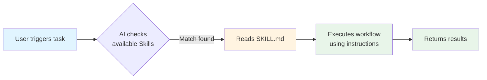

# Skills: Building Reusable AI Workflows

> **Series**: AI Agents for Data Scientists (Part 4 of 4)

In [Part 1](/blog/claude-code-intro), we explored Claude Code's capabilities. In [Part 2](/blog/mcp-model-context-protocol), we connected AI to your data infrastructure. Now, let's talk about **Skills**—reusable instruction sets that transform your AI assistant into a domain expert for your specific workflows.

---

## What are Skills?

Skills are markdown files (stored as `SKILL.md`) that teach your AI assistant how to perform specialized tasks. Think of them as reusable playbooks that encode your team's knowledge, standards, and best practices.



Instead of explaining your workflow every time, you write it once in a Skill file. The AI automatically applies it whenever relevant.

---

## Why Skills Matter for Data Scientists

### 1. Standardize Repetitive Tasks

Data science workflows often involve repetitive steps: data quality checks, model evaluation, report generation. Skills ensure these are done consistently every time.

**Without Skills:**
```
You: "Check data quality for this dataset"
AI: [Generates generic code, may miss your team's specific checks]
```

**With Skills:**
```
You: "Check data quality for this dataset"
AI: [Automatically applies your team's data quality skill]
     ✓ Missing value analysis
     ✓ Outlier detection (IQR method)
     ✓ Duplicate record check
     ✓ Data type validation
     ✓ Generates standardized report
```

### 2. Share Workflows Across Teams

Skills can be stored in your repository (`.cursor/skills/`) and shared with your entire team. New team members get instant access to established workflows.

### 3. Encode Domain Knowledge

Capture your team's hard-won knowledge:
- Which metrics matter for your use cases
- How to handle specific data quality issues
- Standard visualization formats
- Model evaluation criteria

---

## Skill Structure

Skills follow a simple structure with YAML frontmatter and markdown instructions:

```markdown
---
name: data-quality-check
description: Perform comprehensive data quality analysis including missing values, outliers, duplicates, and type validation. Use when analyzing datasets, performing EDA, or when the user asks for data quality checks.
---

# Data Quality Check

## Workflow

1. Load the dataset
2. Check missing values (percentage and patterns)
3. Detect outliers using IQR method
4. Identify duplicate records
5. Validate data types
6. Generate summary report

## Output Format

[Standardized report template here]
```

### Key Components

| Component | Purpose | Example |
|-----------|---------|---------|
| **name** | Unique identifier | `data-quality-check` |
| **description** | When to use (critical for auto-discovery) | "Use when analyzing datasets..." |
| **Instructions** | Step-by-step workflow | "1. Load dataset, 2. Check missing values..." |
| **Examples** | Concrete usage patterns | Code snippets, output formats |

---

## Example Skills for Data Science

### Skill 1: Data Quality Check

**Purpose**: Standardize data quality analysis across projects

```markdown
---
name: data-quality-check
description: Perform comprehensive data quality analysis. Use when analyzing datasets or performing EDA.
---

# Data Quality Check

## Required Checks

- Missing values (count, percentage, patterns)
- Outliers (IQR method for numeric columns)
- Duplicate records
- Data type consistency
- Value ranges and distributions

## Output Format

Generate a markdown report with sections for each check type.
```

### Skill 2: Model Evaluation

**Purpose**: Consistent model evaluation across experiments

```markdown
---
name: model-evaluation
description: Evaluate ML models with standard metrics and visualizations. Use when assessing model performance or comparing models.
---

# Model Evaluation

## Metrics by Task Type

**Classification**: Accuracy, Precision, Recall, F1, ROC-AUC
**Regression**: MAE, RMSE, R², MAPE
**Time Series**: MAE, RMSE, MAPE, Forecast accuracy

## Visualizations

- Confusion matrix (classification)
- Residual plots (regression)
- Feature importance (if available)
- Prediction vs actual scatter plots
```

### Skill 3: Report Generation

**Purpose**: Standardize analysis reports

```markdown
---
name: analysis-report
description: Generate standardized analysis reports. Use when creating reports, summaries, or documentation.
---

# Analysis Report

## Report Structure

1. Executive Summary (2-3 sentences)
2. Key Findings (bullet points with data)
3. Visualizations (with captions)
4. Recommendations (actionable items)
5. Appendix (methodology, assumptions)

## Formatting

- Use markdown tables for numeric summaries
- Include code blocks for reproducibility
- Add timestamps and data source information
```

---

## How to Create Your Own Skill

### Step 1: Identify the Workflow

What repetitive task do you want to automate? Examples:
- Feature engineering patterns
- Model deployment checklists
- Experiment tracking workflows
- Data validation pipelines

### Step 2: Choose Storage Location

| Location | Path | Use Case |
|---------|------|----------|
| **Project** | `.cursor/skills/skill-name/` | Team-wide workflows |
| **Personal** | `~/.cursor/skills/skill-name/` | Personal preferences |

### Step 3: Write the SKILL.md File

Create a directory and add `SKILL.md`:

```bash
mkdir -p .cursor/skills/my-skill
touch .cursor/skills/my-skill/SKILL.md
```

Write clear, concise instructions:

```markdown
---
name: my-skill
description: Brief description with trigger terms. Use when [specific scenarios].
---

# My Skill Name

## Instructions
[Step-by-step guidance]

## Examples
[Concrete examples]
```

### Step 4: Test It

Ask your AI assistant to perform the task. If the skill matches, it will automatically apply.

**Tips for Effective Skills:**
- ✅ Be specific in the description (include trigger terms)
- ✅ Write in third person ("Performs analysis..." not "I can help...")
- ✅ Keep instructions concise (under 500 lines)
- ✅ Include examples for clarity
- ✅ Use consistent terminology

---

## Best Practices

1. **Start Small**: Create skills for your most repetitive tasks first
2. **Iterate**: Refine skills based on actual usage
3. **Document**: Include examples and edge cases
4. **Share**: Store project skills in your repo for team access
5. **Review**: Periodically update skills as workflows evolve

---

## What's Next?

You now have a complete toolkit:
- **Claude Code** for intelligent coding assistance
- **MCP** for connecting to your data infrastructure  
- **Skills** for reusable workflows

Combine these tools to build a powerful AI-powered data science workflow that learns and improves with your team.

---

*This concludes the "AI Agents for Data Scientists" series. Happy building!*

[Back to Blog](/blog/)
