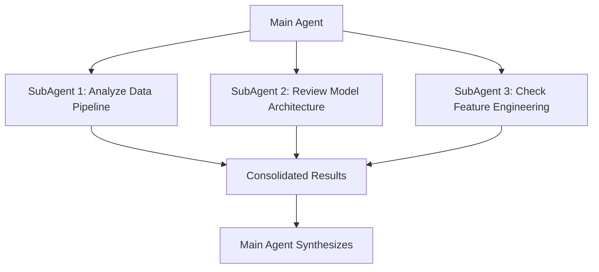

# SubAgents: Parallelizing Your AI-Assisted Analysis

> **Series**: AI Agents for Data Scientists (Part 3 of 4)

As data scientists, we often face complex problems that require exploring multiple angles simultaneously. What if you could spawn multiple AI assistants to work on different aspects of your problem in parallel, just like running concurrent experiments?

Enter **SubAgents**—autonomous AI workers that let you parallelize your analysis and exploration.

---

## What are SubAgents?

SubAgents are independent AI agents spawned by a main agent to handle specific tasks concurrently. Think of them as specialized workers that can explore different parts of your codebase, analyze different hypotheses, or investigate multiple problem angles—all at the same time.



Instead of sequentially asking your AI assistant to explore one module at a time, SubAgents let you delegate multiple exploration tasks simultaneously, dramatically reducing the time needed for comprehensive codebase analysis.

---

## Use Cases for Data Scientists

### 1. Parallel Codebase Exploration

When working with large ML codebases, you often need to understand multiple components:

```
Main Agent: "Analyze this ML project"
├── SubAgent 1: Explore data preprocessing modules
├── SubAgent 2: Review model training scripts
├── SubAgent 3: Examine evaluation and metrics code
└── SubAgent 4: Check deployment and serving logic
```

Each SubAgent works independently, then reports back with findings that the main agent synthesizes.

### 2. Concurrent Data Analysis

Explore multiple hypotheses simultaneously:

```
Main Agent: "Investigate why model performance dropped"
├── SubAgent 1: Analyze data distribution changes
├── SubAgent 2: Check for feature drift
├── SubAgent 3: Review recent code changes
└── SubAgent 4: Examine model predictions vs ground truth
```

### 3. Multi-Angle Problem Investigation

When debugging complex issues, SubAgents can investigate different angles:

- **Data quality**: Missing values, outliers, schema changes
- **Model behavior**: Training dynamics, convergence issues
- **Infrastructure**: Resource constraints, deployment issues
- **Business logic**: Feature calculation errors, label inconsistencies

---

## SubAgent Types

| Type | Description | When to Use |
|------|-------------|-------------|
| **generalPurpose** | Versatile agent for varied tasks | General code analysis, documentation, refactoring |
| **explore** | Specialized for exploration and discovery | Codebase exploration, finding patterns, investigating issues |

**generalPurpose** SubAgents are your go-to for most tasks—they can read files, analyze code, write documentation, and make changes. Use them when you need flexibility.

**explore** SubAgents are optimized for discovery tasks. They excel at searching through codebases, identifying patterns, and gathering information without making changes. Perfect for initial investigation phases.

---

## Practical Example: Analyzing a Large ML Codebase

Imagine you've inherited a complex ML project and need to understand it quickly. Instead of manually exploring each directory, spawn SubAgents:

```python
# Main Agent Prompt:
"Analyze this ML codebase using SubAgents:
1. SubAgent 1 (explore): Map out the data pipeline structure
2. SubAgent 2 (explore): Document the model architecture
3. SubAgent 3 (generalPurpose): Review training scripts for best practices
4. SubAgent 4 (explore): Identify all feature engineering steps"
```

Each SubAgent works in parallel:
- **SubAgent 1** explores `data/` and `preprocessing/` directories
- **SubAgent 2** analyzes model definitions in `models/`
- **SubAgent 3** reviews `train.py` and related scripts
- **SubAgent 4** searches for feature transformation code

Within minutes, you have a comprehensive understanding that would take hours to gather manually.

---

## Best Practices and Tips

### 1. Start with Exploration

Use `explore` SubAgents first to map the territory, then use `generalPurpose` SubAgents for deeper analysis or modifications.

### 2. Give Clear, Focused Instructions

**Less effective:**
```
"SubAgent: Look at the codebase"
```

**More effective:**
```
"SubAgent (explore): Analyze all files in src/preprocessing/ 
and create a summary of data transformation steps, 
including input/output schemas"
```

### 3. Leverage Parallelism

Don't spawn SubAgents sequentially—let them work simultaneously on independent tasks. This is where SubAgents shine.

### 4. Synthesize Results

After SubAgents complete their tasks, have the main agent consolidate findings:
```
"Main Agent: Synthesize the findings from all SubAgents 
into a single architecture overview document"
```

### 5. Use for Time-Consuming Tasks

SubAgents are particularly valuable for:
- Large codebase exploration
- Multi-file refactoring
- Comprehensive documentation generation
- Parallel hypothesis testing

---

## When Not to Use SubAgents

SubAgents add overhead, so skip them for:
- Simple, single-file tasks
- Quick questions or explanations
- Tasks requiring sequential steps with dependencies
- Small codebases where a single agent is sufficient

---

## Integration with Your Workflow

SubAgents work seamlessly with other AI agent capabilities:

1. **Claude Code** (Part 1): Use SubAgents to explore, then Claude Code to implement changes
2. **MCP** (Part 2): SubAgents can leverage MCP connections to query databases or APIs in parallel
3. **This post**: SubAgents for parallel exploration
4. **Next post**: Advanced agent orchestration

---

## Getting Started

1. **Identify parallelizable tasks** in your current project
2. **Start with one SubAgent** to understand the workflow
3. **Scale up gradually** as you become comfortable
4. **Experiment with types** (`explore` vs `generalPurpose`) to see what works best

---

## What's Next?

SubAgents are powerful on their own, but they become even more valuable when orchestrated effectively. In the final post of this series, we'll explore **advanced agent orchestration**—combining SubAgents, MCP connections, and Claude Code into sophisticated workflows for complex data science projects.

---

*This is Part 3 of the "AI Agents for Data Scientists" series. [Read Part 1: Claude Code](/blog/claude-code-intro.html) · [Read Part 2: MCP](/blog/mcp-model-context-protocol.html) · [Read Part 4: Skills](/blog/skills-reusable-ai-workflows.html)*

[Back to Blog](/blog/)
